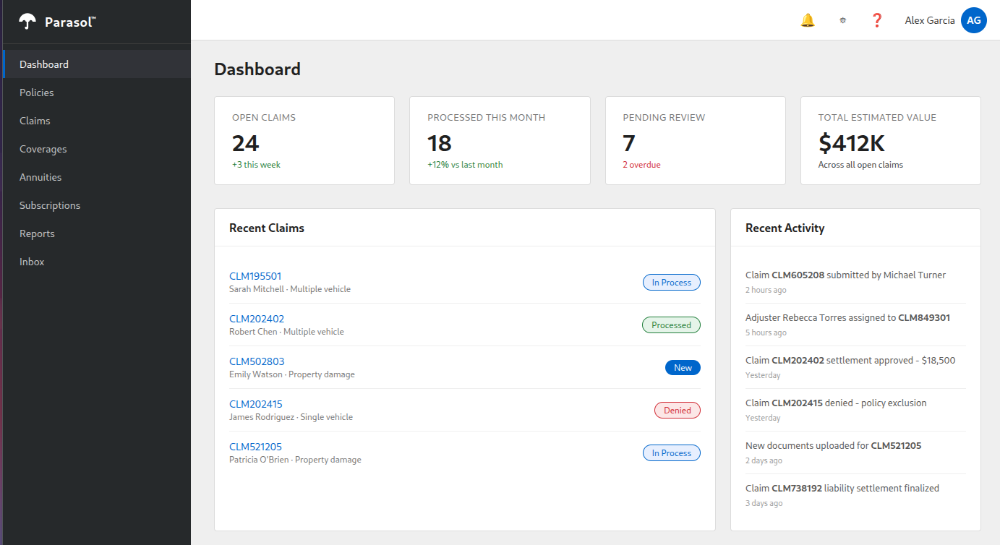

# Parasol Insurance Claims Management

The central application for Parasol Insurance's claims management platform. Built with Quarkus, it provides a dashboard for managing insurance claims, processing customer emails, and tracking claim lifecycle.



## Features

- **Claims Dashboard** -- overview of open claims, processing status, pending reviews, and estimated values
- **Claims Management** -- view, track, and manage insurance claims through their lifecycle (New, In Process, Processed, Denied)
- **Email Intake** -- automated email routing via Kafka: incoming customer emails are classified and routed to Claims, Retention, Acquisition, or flagged for manual review
- **Inbox** -- real-time feed of routed customer emails with department classification

## Technical Stack

| Component | Technology |
|---|---|
| Framework | Quarkus 3.17.5 (Java 17) |
| REST API | Quarkus REST (JAX-RS) with Jackson |
| Database | PostgreSQL with Hibernate ORM Panache |
| Messaging | Apache Kafka via SmallRye Reactive Messaging |
| Health | SmallRye Health (liveness/readiness probes) |
| Container | UBI 9 OpenJDK 21 runtime |

## Project Structure

```
src/main/java/com/parasol/
  ClaimsResource.java       REST API for claims (/api/claims)
  InboxResource.java        REST API for email inbox (/api/inbox)
  EmailRouter.java          Kafka consumer: classifies and routes incoming emails
  EmailGenerator.java       Scheduled email generator (simulates customer emails)
  EmailStore.java           In-memory store for routed emails
  model/
    Claim.java              JPA entity for insurance claims
    Email.java              POJO for routed email messages

src/main/resources/
  META-INF/resources/       Static HTML frontend
    dashboard.html          Main dashboard
    claims.html             Claims list and management
    claim-detail.html       Individual claim view
    inbox.html              Email inbox
    policies.html           Policy management
    coverages.html          Coverage details
    annuities.html          Annuity products
    subscriptions.html      Subscription management
    reports.html            Reporting
  application.properties    Quarkus configuration
  import.sql                Sample claims data (loaded at startup)
```

## REST API

| Endpoint | Method | Description |
|---|---|---|
| `/api/claims` | GET | List all claims |
| `/api/claims/{claimNumber}` | GET | Get a specific claim by number |
| `/api/inbox` | GET | List all routed emails |
| `/api/inbox?after={id}` | GET | List emails received after a given ID |

## Email Routing

The `EmailRouter` consumes JSON messages from a Kafka topic and classifies them:

| Department | Condition |
|---|---|
| **CLAIMS** | Known customer with claim-related keywords |
| **RETENTION** | Known customer, general inquiry |
| **ACQUISITION** | Unknown customer, no claim keywords |
| **REVIEW REQUIRED** | Ambiguous language, needs manual classification |

The `EmailGenerator` produces simulated customer emails every 45 seconds (up to 15) to demonstrate the routing pipeline.

## Configuration

Key properties in `application.properties`:

| Property | Description | Default |
|---|---|---|
| `POSTGRESQL_HOST` | Database hostname | `parasol-db` |
| `POSTGRESQL_DATABASE` | Database name | `parasol` |
| `POSTGRESQL_USER` / `POSTGRESQL_PASSWORD` | DB credentials | `parasol` |
| `KAFKA_TOPIC` | Kafka topic for email intake | `intake` |
| `DEV_KAFKA_PASSWORD` | Kafka SCRAM-SHA-512 password | -- |

## Building

```bash
./mvnw clean package -DskipTests
```

## Container Image

```bash
podman build -f Containerfile -t parasol-insurance-secured .
```
